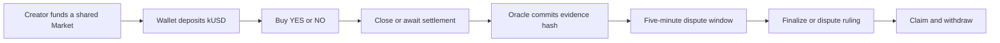

<p align="center">
  <a href="https://sui.kondora.xyz"></a>
</p>

<p align="center"><strong>Pick YES or NO. Choose your leverage. Trade on Sui testnet.</strong></p>

<p align="center">
  <a href="https://kondora-sui.vercel.app/markets">Open the app</a> ·
  <a href="https://kondora-sui.vercel.app/docs">Documentation</a> ·
  <a href="https://kondora-sui.vercel.app/brand">Brand kit</a> ·
  <a href="docs/HACKATHON.md">CLAY submission guide</a>
</p>

Kondora Sui brings [Kondora](https://github.com/enliven17/kondora)'s interface and
agent-driven prediction markets to Sui. Shared Move objects enforce balances,
constant-product execution, up to 5x bounded leverage, full outcome reserves,
evidence-backed oracle proposals, disputes and claims.

**Sui testnet only.** kUSD is a freely mintable demonstration coin with no monetary
value. It is not Circle USDC. Testnet SUI pays network gas. This is a hackathon
prototype; see the [risk notes](content/docs/risks.md).

## How it works



| Layer | Implementation |
| --- | --- |
| Contracts | Sui Move, shared Registry/Account/Market and a test-coin Faucet |
| Wallets | Wallet Standard, current Mysten dApp Kit, testnet-only signing |
| Live reads | Sui gRPC, typed BCS decoding and account ownership checks |
| Backend | Separate Convex deployment, Sui indexing and scheduled agents |
| Website | Next.js 16 on a separate Vercel project |
| Evidence | Exact JSON in Convex, SHA-256 plus a public URI committed on chain |

The original Solana repository is independent and unchanged. The Sui edition uses
a constant-product integer curve; its accounting is implemented in Move and
mirrored in the client. It does not use Solana delegation or session keys.

## Run locally

Use Node.js 22.12+ and npm. Install the Sui CLI to build or test Move.

```sh
git clone https://github.com/enliven17/kondora-sui.git
cd kondora-sui
npm ci
cp .env.example .env.local
npm run dev
```

Set `NEXT_PUBLIC_CONVEX_URL` to your own Convex deployment for live indexed data.
The checked-in testnet package IDs are in [deployments/testnet.json](deployments/testnet.json).
Without Convex, local development explicitly uses demo markets. Never commit local
wallets or environment files.

To deploy a new isolated package, run `npm run sui:deploy`. It creates a local key
in `.keys/sui-deployer.key`, requests testnet gas through the official faucet and
publishes through gRPC. Existing package IDs are preserved unless `--republish`
is explicitly supplied.

## Trade with a local agent

```sh
npm run agent -- keygen
npm run agent -- faucet
npm run agent -- mint
npm run agent -- setup 20
npm run agent -- markets
npm run agent -- quote MARKET_ID yes 5 2
npm run agent -- bet MARKET_ID yes 5 2
```

The CLI builds transactions locally and keeps keys in `.keys/agent.key`. Override
with `SUI_KEY_FILE` or `SUI_PRIVATE_KEY`. No key is sent to the website or a model.
See the [agent guide](content/docs/agents.md).

## Verify and soak

```sh
npm test
npm run move:test
npm run typecheck
npm run lint
npm run build
npm audit
npm run sui:smoke -- --settlement
npm run sui:soak -- --minutes 30 --wallets 4 --interval-ms 2500
```

The smoke test exercises real testnet mint, deposit, opening, partial closing,
withdrawal, unauthorized-withdrawal rejection, proposal, finalization and claim.
The soak checks collateral conservation, debt, outcome liabilities and full vault
reserves while alternating sides and leverage. Read [docs/SOAK.md](docs/SOAK.md)
before a long run. Public testnet endpoints can fail; results and digests remain
in `.soak/`, and generated wallets remain in `.keys/`.

## Repository

| Path | Contents |
| --- | --- |
| `move/kondora/` | Move contracts and adversarial unit tests |
| `lib/sui/` | gRPC, BCS, event indexing and transaction builders |
| `lib/kondora/math.ts` | Integer quote arithmetic matching Move |
| `app/`, `components/` | Original Kondora design adapted to Sui |
| `convex/`, `agents/` | Indexer, creator, oracle, auditor and source adapters |
| `scripts/`, `cli/` | Deployment, smoke, soak and local trading |
| `deployments/` | Public object IDs and verification receipts |
| `brand/`, `public/brand/` | Original artwork with Sui social exports |

Deployment and domain notes: [docs/DEPLOYMENT.md](docs/DEPLOYMENT.md).
